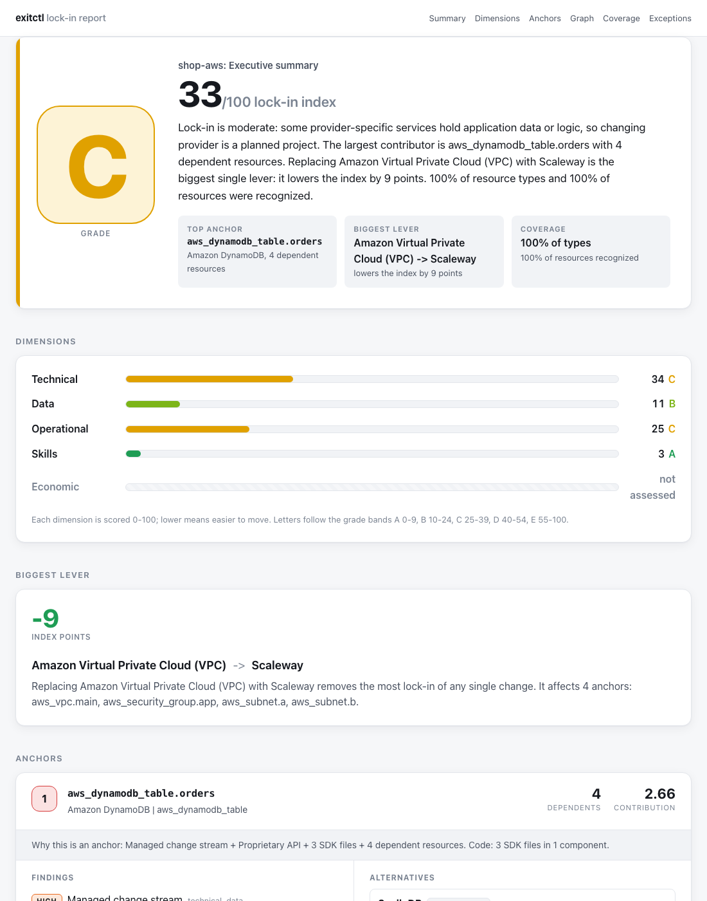

# exitctl

**Estimate how locked in you are to your cloud provider, from your repositories alone.**

`exitctl` (working name) is a command-line tool that reads the infrastructure and application code of one or many repositories and shows how tightly the system is tied to a cloud vendor, which resources hold you there, and what could replace them.

> **It is an estimate.** Use it to assess lock-in in one repository or many, and to decide where to look first. It is not an audit, a migration plan, or a cost figure.

## What it does

Vendor lock-in is easy to feel and hard to measure. Everyone knows the system "uses a lot of AWS", but nobody can say how hard leaving would be, or what to change first. exitctl answers that from the code you already have.

Point it at a repository, or at all of them. It reads your Terraform, Kubernetes manifests and other infrastructure files, and the cloud SDKs your application imports. Then it works out which resources are tied to one provider, and how much other things depend on them. A database that ten services use counts for far more than a forgotten bucket.

You get one number and one letter: the **lock-in index** (0-100, lower is better) and a **grade** from A to E. That gives you something to put in a planning document, track over time, or compare between teams. You also get the reasons behind it:

- **Anchors**: the few resources that hold you in place most, each with the file and line that proves it, and open-source or European alternatives you could move to.
- **The biggest lever**: the single replacement that would lower the index the most, so you know where a migration effort pays off first.

Everything runs on your machine. exitctl is offline and read-only, needs no cloud credentials, and sends nothing anywhere, so you can run it on private repositories and in CI. The same input always gives the same result, and the result records the tool and catalog versions, so you can rerun it and get the same answer. When you need to share it, write an HTML, Markdown or JSON report.

## Quickstart

### Install

**Homebrew** (macOS and Linux):

```sh
brew install cloudowski/tap/exitctl
```

**Install script** (detects your OS and CPU, checks the SHA-256 checksum, and verifies the cosign signature when `cosign` is installed):

```sh
curl -fsSL https://raw.githubusercontent.com/cloudowski/exitctl/main/install.sh | sh
```

It installs to `/usr/local/bin` if that is writable, otherwise to `~/.local/bin`. Set `INSTALL_DIR` to choose another place and `VERSION` to pin a release, for example `curl ... | VERSION=v0.1.0 sh`. You can read the script first: [install.sh](install.sh).

**Direct download.** Pick the line for your platform. It fetches the latest stable release and unpacks the `exitctl` binary into the current directory:

```sh
# Linux, x86-64
curl -fsSL https://github.com/cloudowski/exitctl/releases/latest/download/exitctl_linux_amd64.tar.gz | tar -xz exitctl

# Linux, ARM64
curl -fsSL https://github.com/cloudowski/exitctl/releases/latest/download/exitctl_linux_arm64.tar.gz | tar -xz exitctl

# macOS, Apple Silicon
curl -fsSL https://github.com/cloudowski/exitctl/releases/latest/download/exitctl_darwin_arm64.tar.gz | tar -xz exitctl

# macOS, Intel
curl -fsSL https://github.com/cloudowski/exitctl/releases/latest/download/exitctl_darwin_amd64.tar.gz | tar -xz exitctl
```

Then run `./exitctl version`, or move the binary somewhere on your `PATH`. To get a specific version, replace `latest/download` with `download/v0.1.0`. On macOS, a browser download (not `curl`) may be blocked by Gatekeeper because the binary is not notarized; `xattr -d com.apple.quarantine exitctl` clears that.

**Build from source** (Go required):

```sh
git clone https://github.com/cloudowski/exitctl.git
cd exitctl
make build          # writes bin/exitctl
```

Check the install:

```sh
exitctl version
```

#### Verifying a release

Every release publishes `checksums.txt`, a keyless [cosign](https://github.com/sigstore/cosign) signature bundle for it (`checksums.txt.sigstore.json`), and an SPDX SBOM next to each archive. To verify a download (the example checks the Linux x86-64 archive; use your platform's file name):

```sh
base=https://github.com/cloudowski/exitctl/releases/latest/download
curl -fsSLO $base/exitctl_linux_amd64.tar.gz -O $base/checksums.txt -O $base/checksums.txt.sigstore.json
cosign verify-blob checksums.txt \
  --bundle checksums.txt.sigstore.json \
  --certificate-identity-regexp '^https://github.com/cloudowski/exitctl/\.github/workflows/release\.yml@refs/tags/v' \
  --certificate-oidc-issuer https://token.actions.githubusercontent.com
sha256sum --check --ignore-missing checksums.txt
```

### Run your first scan

Scan a repository:

```sh
exitctl scan path/to/your/repo
```

Example output:

```text
Offline, read-only scan: 14 Terraform resources, 8 K8s objects, 2 images, 3 CI actions, 1 component
  Lock-in index  33/100  grade C
  technical ███░░░░░░░  data █░░░░░░░░░  operational ███░░░░░░░  skills ░░░░░░░░░░

  Top anchors                             dependents  alternatives
  1. aws_dynamodb_table.orders                     4  ScyllaDB, Apache Cassandra +2
     + 3 files in 1 component use Amazon DynamoDB SDK
  2. aws_lambda_function.order_processor           2  Knative, OpenFaaS +1
  ...
  Biggest lever: Amazon Virtual Private Cloud (VPC) -> Scaleway lowers the index by 9 pts
  Coverage: 100% of types, 100% of resources
```

Then dig in:

```sh
exitctl explain 1                  # evidence, dependents and alternatives for anchor #1
exitctl coverage                   # what it did not recognize
exitctl report --format html --open
```

Scan several repositories and combine them into one view:

```sh
exitctl scan ./service-a --no-store --output a.json
exitctl scan ./service-b --no-store --output b.json
exitctl merge a.json b.json -o all.json
exitctl report --input all.json
```

You can also pass several paths to one `scan`. Run `exitctl <command> --help` for all flags.

## Reading the report



The report opens with the grade and index, then shows:

- **Dimensions**: technical, data, operational and skills, each scored 0-100. Economic lock-in is not assessed.
- **Biggest lever**: the replacement that removes the most lock-in.
- **Anchors**: ranked resources, each with its findings (level and dimension), evidence, dependents and alternatives.
- **Graph**, **Coverage** and **Exceptions**.

## Grades and scores

The **lock-in index** runs from 0 (no lock-in) to 100. It is the weighted average risk of every recognized resource, and resources with more dependents weigh more.

| Grade | Index  | What it means                                                                                                  |
| ----- | ------ | -------------------------------------------------------------------------------------------------------------- |
|  | 0-9    | Minimal lock-in: the system relies on portable building blocks, so changing provider is mostly configuration. |
|  | 10-24  | Low lock-in: a few provider-specific add-ons, not the core, each with known alternatives.                      |
|  | 25-39  | Moderate lock-in: some provider-specific services hold application data or logic; a move is a planned project. |
|  | 40-54  | High lock-in: provider-specific services are an important part of how the system runs; a move needs a plan.    |
|  | 55-100 | Very high lock-in: the system is built around one provider's services, including data and logic; a redesign.   |


A grade describes how hard it is to change provider. It is not a cost estimate, and lock-in can be a reasonable choice.

**Range.** When exitctl doesn't recognize some resources, the result adds a range (e.g. `34-44`) showing how far the index could move.

**Coverage and confidence.** The grade is only as good as what exitctl recognized:

| Weighted coverage | What you see                                         |
| ----------------- | ---------------------------------------------------- |
| 90% or more       | index and grade                                      |
| 70% to 90%        | index and grade marked provisional, plus the range   |
| below 70%         | no grade ("insufficient coverage"), only the range   |

`exitctl coverage` lists the unrecognized types, most important first.

**Dimensions.** Each finding belongs to one or more dimensions: *technical* (APIs, SDKs, runtimes), *data* (formats, models), *operational* (tooling, monitoring) and *skills* (provider-specific team knowledge).

The full formulas, weights and the reasoning behind the bands are in [docs/scoring.md](docs/scoring.md).

## How it is checked against real repositories

A score is only useful if it matches what an engineer would say about the same repository. So the grade bands and the catalog are calibrated against a **corpus** of 33 public repositories ([calibration/corpus.yaml](calibration/corpus.yaml)):

- It mixes sample apps, reusable Terraform modules and real infrastructure repositories, across AWS, Google Cloud, Azure, Oracle Cloud, plain Kubernetes and a few public-sector platforms.
- Each repository is pinned to an exact commit, so a calibration run is reproducible.
- Each one has an **expected grade band** (for example "B-C"), based on what it contains: managed-service heavy repositories should land high, mostly Kubernetes and open-source ones low.

The developer tool `go run ./tools/calibrate --corpus calibration/corpus.yaml` clones the corpus, scans every repository with the built-in catalog and default scoring, and compares the grade with the expected band. A release has to pass a gate: at least 90% of repositories within their band, none more than one grade off, and median weighted coverage of at least 90%. Expected bands come from the repository's contents, never from the tool's output.

**Status:** the grade scale changed from A-F to A-E on 2026-10-11, so all 33 expected bands were converted and are marked *unconfirmed* until a maintainer reviews each one. Treat the calibration as work in progress, not as a measured accuracy figure.

## Supported resources

exitctl reads **what is in the repository**. It does not talk to any cloud.

### Infrastructure and platform files

| Kind                    | What is recognized                                                                 |
| ----------------------- | ---------------------------------------------------------------------------------- |
| Terraform / OpenTofu    | `.tf`, `.tofu`, `.tf.json`, `.tofu.json`                                           |
| CloudFormation          | YAML/JSON templates (found by content)                                             |
| AWS CDK                 | constructs in TypeScript, JavaScript, Python, Java, Kotlin, Go     |
| Pulumi                  | `Pulumi.yaml` projects                                                             |
| Kubernetes              | plain manifests (found by content)                                                 |
| Helm                    | charts (`Chart.yaml`), rendered with optional values files (`--values <chart-dir>=<file>`) |
| Kustomize               | `kustomization.yaml`                                                               |
| Containers              | `Dockerfile*` base images                                                          |
| CI/CD                   | GitHub Actions (`.github/workflows`), GitLab CI (`.gitlab-ci.yml`)                 |

CDK code is read statically and never run.

### Cloud SDKs in application code

exitctl reads dependency manifests and lockfiles, then scans those components' source files for imports and usage.

| Language          | Manifests and lockfiles                                                                 | Source files                 |
| ----------------- | --------------------------------------------------------------------------------------- | ---------------------------- |
| JavaScript / TypeScript | `package.json`, `package-lock.json`, `yarn.lock`, `pnpm-lock.yaml`, `bun.lock`   | `.js .mjs .cjs .ts .tsx .jsx` |
| Python            | `requirements*.txt`, `pyproject.toml`, `poetry.lock`, `Pipfile.lock`, `uv.lock`, `pdm.lock` | `.py`                    |
| Go                | `go.mod`                                                                                | `.go`                        |
| Java / Kotlin / Scala | `pom.xml`, `build.gradle(.kts)`                                                     | `.java .kt .scala`           |
| .NET              | `*.csproj`, `packages.lock.json`, `*.deps.json`                                         | `.cs`                        |
| Ruby              | `Gemfile`, `Gemfile.lock`                                                               | `.rb .rake`                  |
| PHP               | `composer.json`, `composer.lock`                                                        | `.php`                       |
| Rust              | `Cargo.toml`, `Cargo.lock`                                                              | `.rs`                        |

It also reads SBOM files.

### Providers and services

The built-in catalog covers services from **AWS, Google Cloud, Microsoft Azure and Oracle Cloud**, plus Kubernetes, with open-source and European alternatives. The entries are plain YAML files in [catalog/](catalog/). Anything outside the catalog is reported as an unknown type and lowers coverage.

### What it does not detect

**exitctl sees only what is declared in your repositories: infrastructure code, manifests and the SDKs your application code uses.** It does not detect lock-in in the platform itself:

- Resources created by hand in a console or other tooling, and absent from code.
- Your actual cloud account, its inventory, data volumes, IAM state or live configuration.
- Costs, contracts, commitments or discounts (the economic dimension is not assessed).
- Anything resolved only at run time, such as resources created in loops or helpers, or SDK clients chosen dynamically.

Treat a clean result as "no lock-in found in the code you scanned", not "no lock-in".

## Configuration

Put an optional `.exitctl.yaml` in the scan root to set the repository name, ignore paths, Helm values files, scoring weights, and **exceptions** (accepted findings with an owner and a reason, excluded from the score). The schema is in [schemas/config.schema.json](schemas/config.schema.json). Any scoring override is marked in the result as custom scoring.

## Support

- Bugs and questions: open an issue at <https://github.com/cloudowski/exitctl/issues>.
- Direct contact: [tomasz@cloudowski.com](mailto:tomasz@cloudowski.com).
- When you report a problem, include the output of `exitctl version`, the command you ran, and `exitctl coverage` if the result looks wrong.
- Missing a service or SDK? See [catalog/CONTRIBUTING.md](catalog/CONTRIBUTING.md). New services are catalog entries, not code changes.

## License

Apache License 2.0. See [LICENSE](LICENSE).
