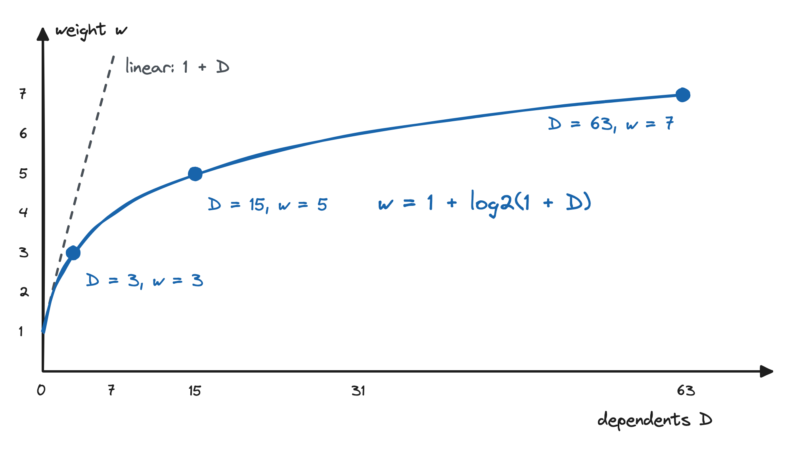
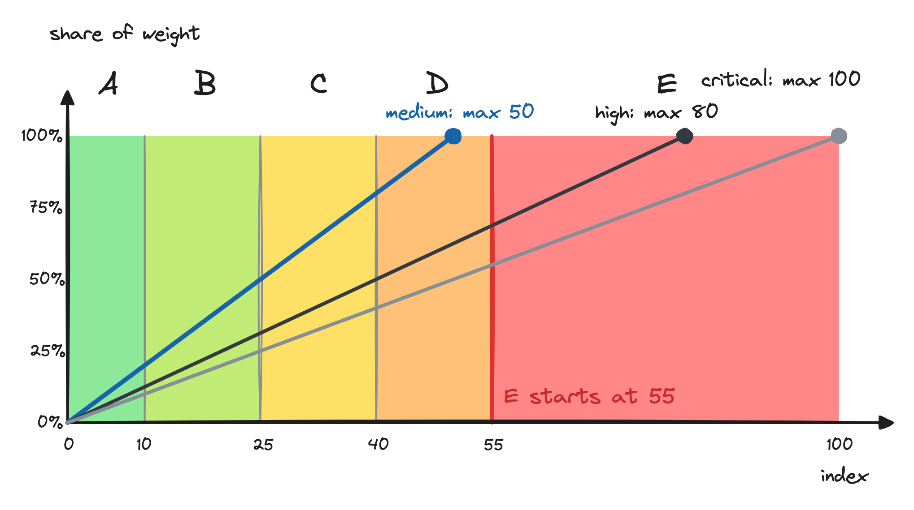

# How exitctl scores lock-in

exitctl turns what it finds in your repositories into one number, the **lock-in index**
(0 to 100), a **grade** (A to E), five **dimension scores**, a ranked list of **anchors**, and
one **biggest lever**. This page explains every step, with the exact formulas the tool uses.

The short version:

1. Each finding has a level and one or more dimensions. The worst finding on a resource sets
   the resource's **risk** r, between 0 and 1.
2. Each node gets a **weight** w that grows with the number of things depending on it.
3. The index is the weighted average risk, times 100.
4. Resources the catalog does not recognize are left out of the index but produce a **range**
   and lower the **coverage**, which decides whether a grade is shown.

For what nodes, edges, and dependents are, see [graph.md](./graph.md).

## Inputs: findings, levels, dimensions

A **finding** is one lock-in fact about one node, for example "Proprietary API" on a DynamoDB
table. It comes from the catalog: the service's traits, rules that matched the resource's
attributes, SDK usage found in code, or a Kubernetes binding. Every finding has evidence
(file and line).

Each finding has a **level** and one or more **dimensions**. Both map to weights:

| Level    | Default weight |
| -------- | -------------- |
| none     | 0              |
| low      | 0.25           |
| medium   | 0.5            |
| high     | 0.8            |
| critical | 1.0            |

| Dimension   | Default weight | What it means                                      |
| ----------- | -------------- | -------------------------------------------------- |
| data        | 1.0            | data formats, data volume, data models             |
| technical   | 0.9            | APIs, SDKs, runtimes, proprietary features         |
| operational | 0.7            | tooling, monitoring, operating procedures          |
| skills      | 0.5            | team knowledge specific to the provider            |
| economic    | 0              | not assessed in the open source core               |

A finding is either **active** or **accepted** (see [Exceptions](#exceptions)). Only active
findings count.

## Per-node values

For one finding f:

```text
lw(f) = level_weights[f.level]
dw(f) = max(dimension_weights[d] for d in f.dimensions)
```

**Resource risk** r(n) is the worst active finding, normalized so the worst possible finding
is 1:

```text
norm  = max(level_weights) * max(dimension_weights)        # 1.0 with defaults
r(n)  = max(lw(f) * dw(f) for active findings f of n) / norm
r(n)  = 0 when n has no active findings
```

Only the worst finding counts. Five medium findings do not add up to a high one; they tell
you more about the resource in `explain`, but the risk is set by the strongest coupling.

**Dependents** D(n) is the number of nodes that depend on n directly or through a chain of
dependencies (see [graph.md](./graph.md#dependents-and-blast-radius)).

**Weight** grows with dependents, with diminishing returns:

```text
w(n) = 1 + log2(1 + D(n))
```

| D   | 0 | 1 | 3 | 7 | 15 | 31 |
| --- | - | - | - | - | -- | -- |
| w   | 1 | 2 | 3 | 4 | 5  | 6  |

A resource that many things depend on weighs more, because replacing it moves more of your
system. Doubling the dependents adds about one unit of weight, so one widely used resource
does not drown out everything else.

**Contribution** is what a node adds to the index numerator:

```text
contrib(n) = w(n) * r(n)
```

Stored per-node values (risk, weight, contribution) are rounded half-up to 4 decimals.

## Which nodes are scored

- **Scored set S**: resources recognized by the catalog as a service or as neutral, plus
  implied service nodes (services used from code but not declared in the scanned
  infrastructure). Neutral resources usually have r = 0; they are in S because they are a real,
  known part of your estate.
- **Unknown set U**: resources whose type the catalog does not recognize (`unknown`), or only
  recognizes through a draft entry that is not yet reviewed (`unverified`).
- **Not scored**: resources of types that deploy nothing, such as lookups
  (`data "aws_caller_identity"`, `aws_iam_policy_document`), local-only types (`random_*`,
  `time_*`, `tls_*`), and metadata files. The catalog marks them with `scored: false`. They are
  in neither S nor U, so they change neither the index, the range, nor coverage, and they do not
  count as dependents of other resources. They still appear in the graph, marked
  `(not scored)`, and `exitctl coverage` lists them. Before rules version 1.1.0 they counted as
  neutral, which pulled the index of repositories with many lookups down.
- **Application components** are never scored themselves. They make other nodes heavier
  (as dependents) and bring SDK findings to the services they use.

## Index, range, and coverage

```text
index      = round_half_up(100 * Σ_S w*r / Σ_S w)
lower      = round_half_up(100 * Σ_S w*r / (Σ_S w + Σ_U w))            # unknowns as risk 0
upper      = round_half_up(100 * (Σ_S w*r + Σ_U w) / (Σ_S w + Σ_U w))  # unknowns as risk 1
coverage_w = Σ_S w / (Σ_S w + Σ_U w)
```

`round_half_up(x)` is `floor(x + 0.5)`. Sums run over nodes sorted by ID, and every product is
computed in float64 explicitly, so the index is identical on every machine and architecture.

Unknown resources are **excluded** from the index, but they never disappear:

- They stay in the graph, so they still count as dependents of other nodes.
- The **range** (lower to upper) shows what the index could be if every unknown resource had
  no lock-in or full lock-in, each with its real graph weight. The range is shown whenever at
  least one unknown resource exists.
- The **weighted coverage** decides how much trust the grade deserves.

If S is empty (nothing recognized), no index is produced and the status is
`nothing_scored`.

### Coverage figures

exitctl reports three coverage numbers:

| Figure                | Formula                                                      | Used for            |
| --------------------- | ------------------------------------------------------------ | ------------------- |
| `coverage.types`      | distinct recognized resource types / distinct resource types | summary line        |
| `coverage.resources`  | recognized resources / (recognized + unknown resources)      | summary line        |
| `coverage.weighted`   | coverage_w above                                             | grade confidence    |

The summary also gives the number of unknown types; `exitctl coverage` lists them, sorted by
how many nodes depend on them, so you know which gaps matter most.

### Confidence and grade

| Weighted coverage   | Confidence    | What you see                                         |
| ------------------- | ------------- | ---------------------------------------------------- |
| >= 0.90             | `normal`      | index and grade                                      |
| >= 0.70 and < 0.90  | `provisional` | index and grade marked provisional, plus the range   |
| < 0.70              | `withheld`    | no grade ("insufficient coverage"), only the range   |

When a grade is given, it comes from the index:

| Grade | Index  | What it means                                                                                                  |
| ----- | ------ | -------------------------------------------------------------------------------------------------------------- |
| A     | 0-9    | Minimal lock-in: the system relies on portable building blocks, so changing provider is mostly configuration.  |
| B     | 10-24  | Low lock-in: a few provider-specific add-ons, not the core, each with known alternatives.                      |
| C     | 25-39  | Moderate lock-in: some provider-specific services hold application data or logic; a move is a planned project. |
| D     | 40-54  | High lock-in: provider-specific services are an important part of how the system runs; a move needs a plan.   |
| E     | 55-100 | Very high lock-in: the system is built around one provider's services, including data and logic; a redesign.  |

A grade describes how hard it is to change provider. It is not a cost estimate, and lock-in can be a
reasonable choice. The same sentences appear in the HTML and Markdown reports.

The scale has five grades, A to E, and its colors run from green (A, low lock-in) to red (E, very high lock-in). Every grade is always shown together with its letter, so color is never the only signal.

### Where the weight comes from



A node counts as `w = 1 + log2(1 + D)`, where `D` is the number of resources that depend on it.
A node nothing depends on weighs 1, one dependent doubles the weight, and from then on each
doubling of the dependents adds one point. A hub with 63 dependents weighs 7 times a leaf, not
64 times as it would if the weight grew linearly (the dashed line), so one central node does
not drown out the rest of the repository.

### Why E starts at 55



The index is a weighted average of node risk, so a repository reaches index `I` when a share
`I / (100 * r)` of its weight sits at risk level `r`. Each line in the figure shows that share
for one level: `medium` (r = 0.5), `high` (r = 0.8) and `critical` (r = 1.0). A line stops where
the share reaches 100%. If every risky node were only `medium`, the index could not exceed 50,
so E needs `high` or `critical` lock-in on most of the weight: 69% of it at `high`, or 55% at
`critical`. The lower grades follow the same logic for `medium`: B starts when 20% of the
weight is at `medium`, C at 50%, D at 80%.

The pictures can be edited in [Excalidraw](https://excalidraw.com): open the
`images/*.excalidraw` file, change it, and export a PNG over the one next to it.

### Dimension scores

Each dimension gets its own score with the same weighting. A node's value in dimension d is
the highest level weight among its active findings in that dimension, without the dimension
weight:

```text
r_d(n)  = max(lw(f) for active findings f of n with d in f.dimensions)    # 0 if none
dim[d]  = round_half_up(100 * Σ_S w*r_d / Σ_S w)
```

Dimension scores are computed for every dimension whose weight is above 0. The economic
dimension has weight 0 by default and is shown as "not assessed".

### Worked example

Three recognized resources and one unknown, default weights:

| Node | Findings (worst)              | r                     | D | w | w*r  |
| ---- | ----------------------------- | --------------------- | - | - | ---- |
| A    | high, dimensions data+technical | 0.8 x 1.0 = 0.8     | 3 | 3 | 2.4  |
| B    | neutral, no findings          | 0                     | 0 | 1 | 0    |
| C    | medium, technical             | 0.5 x 0.9 = 0.45      | 0 | 1 | 0.45 |
| X    | unknown type                  | -                     | 1 | 2 | -    |

```text
index      = round(100 * 2.85 / 5)        = 57
lower      = round(100 * 2.85 / 7)        = 41
upper      = round(100 * (2.85 + 2) / 7)  = 69
coverage_w = 5 / 7                        = 0.71  -> provisional
grade      = C (provisional), range 41-69
```

## Anchors

An **anchor** is a scored node ranked by its contribution w x r. Anchors are what holds you to
a provider: they combine high risk with many dependents.

- Ranking: contribution descending, ties by node ID ascending. Nodes with contribution 0 are
  not anchors.
- The summary shows the top 5 (`top_anchors`); `--all` shows every anchor.
- Each anchor lists its dependents count, the number of application components that use it
  through an SDK and the number of source files with that usage, its alternatives in display
  order, and a short reason, for example
  `Proprietary API + Proprietary data model + 4 SDK files + 12 dependent resources`.

## Biggest lever

The **biggest lever** is the single service replacement that would lower the index the most.
It turns the diagnosis into one concrete decision.

It is computed by simulation, not estimated:

1. For each service present in the scored set that has at least one alternative mapping, pick
   its preferred alternative: the recommended one, else the one with the lowest difficulty,
   then by name.
2. On every node of that service, replace the active findings with the alternative's
   **residual traits** (the lock-in that remains after switching, as recorded in the catalog),
   using the original declaration as evidence. Accepted findings stay accepted.
3. Recompute the index. The graph, and therefore every weight, stays unchanged.
4. `delta = index - simulated index`.

The lever is the service with the largest delta; ties go to the lower difficulty, then the
service ID. The summary prints
`Biggest lever: <service> -> <alternative> lowers the index by N pts`. When no replacement
lowers the index, no lever is shown.

The `recommended` flag only decides which alternative is simulated when one is recommended. It
never changes any score directly.

## Exceptions

Sometimes a team keeps a managed service on purpose. Record that decision as an exception in
`.exitctl.yaml` at the repository root:

```yaml
version: 1
exceptions:
  - id: keep-cognito
    select: {service: aws.cognito}
    reason: Identity migration is planned for 2027; accepted until then.
    owner: platform-team
    expires: 2027-01-01
```

- `select` takes exactly one of `finding` (a finding ID `<node-id>::<trait-id>`), `resource`
  (native address or canonical ID), `service`, or `trait`; `resource` may be combined with
  `trait`.
- `reason` and `owner` are required. `expires` is optional (`YYYY-MM-DD`).
- Expiry is compared with the reference date: `--as-of` when given, else today. The reference
  date is recorded in the result, so the same inputs give the same output. An exception is
  still active on its `expires` day and expired from the next day. For `merge`, the reference
  date is the latest `as_of` among the inputs.

Each exception is `active`, `expired`, or `invalid` (missing reason or owner, or a selector
that matches nothing). Findings matched by an active exception become `accepted`:

- They are excluded from r. The resource itself stays in the scored set and in the
  denominator, so accepting lock-in does not make the rest of the estate look riskier or
  safer than it is.
- They remain visible in `explain` and reports, with reason and owner.
- The summary shows the number of accepted exceptions and the **index without exceptions**,
  so exceptions can never hide lock-in silently.
- Expired and invalid exceptions are ignored, their findings count again, and a notice names
  them.

## Configuration

All scoring parameters can be overridden in the `scoring` section of `.exitctl.yaml`:

```yaml
version: 1
scoring:
  level_weights: {high: 0.75}
  dimension_weights: {skills: 0.4}
  coverage_thresholds: {normal: 0.95, provisional: 0.8}
  top_anchors: 10
  group_threshold: 80
```

| Key                   | Default                                                     | Notes                                      |
| --------------------- | ----------------------------------------------------------- | ------------------------------------------ |
| `level_weights`       | none 0, low 0.25, medium 0.5, high 0.8, critical 1.0        | each in [0, 1]; listed keys override       |
| `dimension_weights`   | data 1.0, technical 0.9, operational 0.7, skills 0.5, economic 0 | each in [0, 1]; economic must stay 0; at least one > 0 |
| `grade_bands`         | A 0-9, B 10-24, C 25-39, D 40-54, E 55-100                  | replaces the whole list; contiguous, covering 0-100 |
| `coverage_thresholds` | normal 0.90, provisional 0.70                               | 0 <= provisional <= normal <= 1            |
| `top_anchors`         | 5                                                           | anchors in the summary, 1-20               |
| `group_threshold`     | 50                                                          | node count above which container grouping applies (see [graph.md](./graph.md#grouping)) |

Every result records a configuration fingerprint (the first 8 hex characters of the SHA-256 of
the effective scoring configuration). When the effective configuration differs from the
defaults, the result is marked **custom scoring**, so two indexes are only compared when they
were computed the same way.

## Calibration

The formulas are fixed; the weights are calibrated. The project keeps a corpus of public
repositories with expected grade bands, and every change to weights, bands, traits, or rules
is checked against it before release.

## Glossary

**Anchor**
: A scored node ranked by contribution (weight x risk). The top anchors are the resources that
  hold you to a provider most: high lock-in combined with many dependents.

**Biggest lever**
: The one service replacement, service -> its preferred alternative, that lowers the index the
  most when simulated with the alternative's residual traits on the unchanged graph.

**Contribution**
: w x r of a node; its share of the index numerator.

**Coverage**
: How much of what was found the catalog recognizes. It exists so a partial picture is never
  mistaken for a complete one. Type coverage counts distinct resource types (for example
  "70% of resource types recognized (14 of 20)"), resource coverage counts resources, and
  weighted coverage weighs each resource by its dependents and decides whether the grade is
  normal, provisional, or withheld. A very low type coverage means most resource types in the
  scan are unknown or only matched by unreviewed catalog drafts; `exitctl coverage` lists
  them.

**Dependents**
: All nodes that depend on a node directly or transitively.

**Dimension**
: The kind of lock-in: data, technical, operational, skills, economic.

**Exception**
: A recorded, owned decision to accept specific lock-in. Accepted findings leave the index but
  stay visible, and the index without exceptions is always shown.

**Finding**
: One lock-in fact on one node, with level, dimensions, and evidence.

**Index range**
: The index recomputed with every unknown resource at risk 0 (lower) and risk 1 (upper).

**Level**
: Severity of a finding: none, low, medium, high, critical.

**Lock-in chain**
: A dependency path in which every step carries at least medium risk. See
  [graph.md](./graph.md#lock-in-chains).

**Migration wave**
: A set of nodes that can move once all earlier waves have moved. See
  [graph.md](./graph.md#cycles-and-migration-waves).

**Residual traits**
: Lock-in that remains after switching to an alternative, recorded in the catalog mapping.

**Risk (r)**
: The normalized severity of a node's worst active finding, 0 to 1.

**Unknown vs unverified**
: Both are left out of the index and count against coverage. An **unknown** resource has a type
  the catalog does not know at all. An **unverified** resource has a type that a draft catalog
  entry would recognize, but the entry has not been reviewed yet, so it does not affect
  results; it is listed under unverified matches.

**Weight (w)**
: 1 + log2(1 + dependents). How much a node counts in the index.
